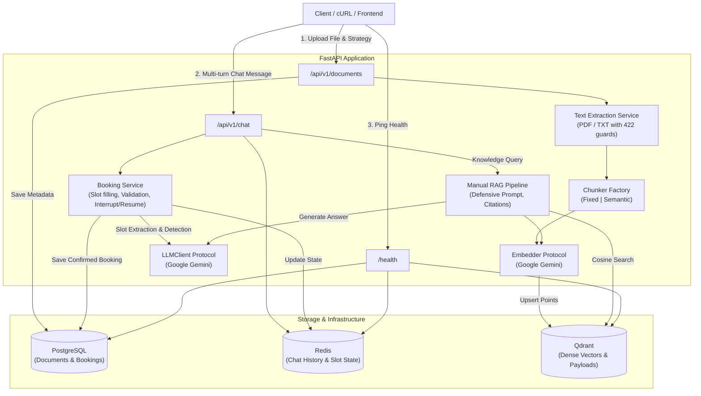

# PalmMind RAG & Conversational Booking API

[](https://www.python.org/downloads/)
[](https://fastapi.tiangolo.com)
[](https://qdrant.tech/)
[](https://www.postgresql.org/)
[](https://redis.io/)
[](https://github.com/astral-sh/ruff)
[](https://mypy-lang.org/)

Production-grade take-home backend implementing a document ingestion pipeline with selectable chunking strategies (Fixed & Semantic), low-latency vector search with Qdrant, relational metadata with PostgreSQL (SQLAlchemy 2.0 async), Redis-backed multi-turn conversational memory, and native in-chat interview booking slot filling with interrupt/resume capabilities.

---

## Architecture Diagram



---

## Key Features

1. **Document Ingestion API (`POST /api/v1/documents`)**:
   - Accepts `.pdf` or `.txt` multipart uploads.
   - Comprehensive validation: extension, MIME type, max upload size.
   - Handles empty files or scanned PDFs lacking extractable text with clear `422 Unprocessable Entity` errors (`DOCUMENT_EXTRACTION_ERROR`).
   - Idempotent point upsertion in Qdrant with deterministic UUIDs and rich metadata payloads (`document_id`, `chunk_index`, `text`, `filename`, `chunking_strategy`).
   - Persists document metadata in PostgreSQL using SQLAlchemy 2.0 async `Mapped[]` models.

2. **Selectable Chunking Strategies**:
   - `fixed`: Length-based chunking with configurable window size and overlap, respecting word boundaries to prevent token fragmentation.
   - `semantic`: Embedding-based semantic boundary detection. Splits text into sentences, computes adjacent sentence cosine similarity transitions, and introduces chunk boundaries where similarity drops below a threshold, guarded by min and max chunk length bounds.
   - Pluggable `Chunker` Protocol resolved via `ChunkerFactory`.

3. **Conversational RAG API (`POST /api/v1/chat`)**:
   - **No LangChain `RetrievalQAChain`**: Entirely custom, manual RAG pipeline.
   - Embeds user query, queries Qdrant for top-$k$ nearest neighbors with configurable score thresholding.
   - Grounded with a defensive system prompt: answers strictly from retrieved context, explicitly admits lack of information, and ignores prompt injections embedded within documents.
   - Cites sources with document ID, filename, chunk index, similarity score, and excerpt snippets.

4. **Internal Conversational Interview Booking**:
   - LLM detects scheduling intent and extracts candidate details (`name`, `email`, `date`, `time`).
   - Validates candidate emails with Pydantic `EmailStr` and dates with custom validators that reject past dates.
   - Session-scoped slot state persisted in Redis across multiple turns.
   - Supports **interruption and resumption**: users can pause booking to ask knowledge questions, receive grounded RAG answers, and resume scheduling without losing progress.
   - Persists confirmed booking records to PostgreSQL.

5. **Production Code Quality**:
   - Strict static typing: clean `mypy --strict`.
   - Linting & formatting: clean `ruff check` and `ruff format`.
   - Pluggable Protocols: `Embedder`, `LLMClient`, `Chunker`, `VectorStore`, `MemoryService`.
   - Centralized exception hierarchy mapping domain errors to uniform JSON error envelopes.
   - Clean, modular architecture with strict static typing via `mypy --strict`.

---

## Quickstart with Docker Compose

To spin up the entire stack (PostgreSQL, Redis, Qdrant, and the FastAPI application) in one command:

```bash
# 1. Clone repository and copy environment configuration
cp .env.example .env

# Add your Gemini API key in .env
# If omitted, the service will not be able to function properly.

# 2. Build and launch services
make up
# or: docker-compose up --build -d
```

Verify service readiness:
```bash
curl http://localhost:8000/health
```

Stop services:
```bash
make down
```

---

## Local Development Setup

To run directly on macOS or Linux with a local Python 3.11+ environment:

```bash
# 1. Activate your virtual environment (e.g. source ~/myenv/bin/activate)
source ~/myenv/bin/activate

# 2. Install dependencies
pip install -e ".[dev]"

# 3. Start backing services (Postgres, Redis, Qdrant) via docker-compose
docker-compose up -d postgres redis qdrant

# 4. Run database migrations
make migrate
# or: alembic upgrade head

# 5. Start the local API server
make run
# or: uvicorn app.main:app --host 0.0.0.0 --port 8000 --reload
```

---

## Development & Testing Commands

The project includes a `Makefile` automating common quality workflows:

| Command | Action |
| :--- | :--- |
| `make up` | Start backing services and API via Docker Compose (`docker compose up --build -d`) |
| `make down` | Stop and remove all Docker containers and volumes |
| `make lint` | Run code quality checks via `ruff check .` |
| `make format` | Auto-format codebase using `ruff format .` |
| `make typecheck` | Run static type analysis using `mypy app` |
| `make migrate` | Apply latest Alembic database migrations |
| `make run` | Launch FastAPI app locally with auto-reload |

---

## Environment Variables

| Variable | Type | Default | Description |
| :--- | :--- | :--- | :--- |
| `APP_ENV` | `str` | `development` | Environment mode (`development`, `production`, `testing`) |
| `APP_HOST` | `str` | `0.0.0.0` | Bind host address |
| `APP_PORT` | `int` | `8000` | Bind port number |
| `LOG_LEVEL` | `str` | `INFO` | Logging verbosity (`DEBUG`, `INFO`, `WARNING`, `ERROR`) |
| `DATABASE_URL` | `str` | `postgresql+asyncpg://...` | Async SQLAlchemy PostgreSQL connection string |
| `REDIS_URL` | `str` | `redis://localhost:6379/0` | Redis connection URL |
| `REDIS_CHAT_TTL_SECONDS` | `int` | `86400` | Expiration time for chat memory and slot states (24 hours) |
| `REDIS_MAX_TURNS` | `int` | `10` | Maximum conversational turns retained per session |
| `QDRANT_URL` | `str` | `http://localhost:6333` | Qdrant vector database URL |
| `QDRANT_API_KEY` | `str` | `None` | Optional Qdrant API key |
| `QDRANT_COLLECTION_NAME` | `str` | `document_chunks` | Qdrant vector collection name |
| `GEMINI_API_KEY` | `str` | `""` | Google Gemini API key (required) |
| `GEMINI_CHAT_MODEL` | `str` | `gemini-3.5-flash-lite` | Gemini chat model |
| `GEMINI_EMBEDDING_MODEL`| `str` | `gemini-embedding-2`| Gemini dense embedding model |
| `GEMINI_EMBEDDING_DIMENSIONS` | `int` | `768` | Embedding vector dimensionality (768, 1536, or 3072) |
| `MAX_UPLOAD_SIZE_BYTES` | `int` | `10485760` | Maximum upload file size (10 MB) |
| `RAG_TOP_K` | `int` | `4` | Number of chunks retrieved for RAG context |
| `RAG_SCORE_THRESHOLD` | `float` | `0.3` | Minimum cosine similarity score cutoff |
| `FIXED_CHUNK_SIZE` | `int` | `500` | Fixed chunk window length in characters |
| `FIXED_CHUNK_OVERLAP` | `int` | `100` | Fixed chunk overlap length in characters |
| `SEMANTIC_SIMILARITY_THRESHOLD` | `float` | `0.75` | Cosine similarity breakpoint threshold |
| `SEMANTIC_MIN_CHUNK_SIZE` | `int` | `100` | Minimum character length before semantic split allowed |
| `SEMANTIC_MAX_CHUNK_SIZE` | `int` | `1000` | Maximum character length forcing a chunk split |

---

## API Endpoints & Example cURL Commands

### 1. Health Check
```bash
curl -X GET "http://localhost:8000/health"
```

### 2. Ingest Document (Fixed Chunking)
```bash
curl -X POST "http://localhost:8000/api/v1/documents" \
  -F "file=@docs/sample.txt" \
  -F "chunking_strategy=fixed"
```

### 3. Ingest Document (Semantic Chunking)
```bash
curl -X POST "http://localhost:8000/api/v1/documents" \
  -F "file=@docs/sample.txt" \
  -F "chunking_strategy=semantic"
```

### 4. List Documents & Fetch Metadata
```bash
# List all documents
curl -X GET "http://localhost:8000/api/v1/documents"

# Get specific document metadata
curl -X GET "http://localhost:8000/api/v1/documents/{document_id}"
```

### 5. Conversational RAG Query
```bash
curl -X POST "http://localhost:8000/api/v1/chat" \
  -H "Content-Type: application/json" \
  -d '{
    "message": "What backend technologies does PalmMind use?"
  }'
```

### 6. Multi-Turn Interview Booking Flow

#### Turn 1: Intent Detection
```bash
curl -X POST "http://localhost:8000/api/v1/chat" \
  -H "Content-Type: application/json" \
  -d '{
    "session_id": "session-123",
    "message": "I would like to schedule an interview."
  }'
```

#### Turn 2: Provide Name and Email
```bash
curl -X POST "http://localhost:8000/api/v1/chat" \
  -H "Content-Type: application/json" \
  -d '{
    "session_id": "session-123",
    "message": "My name is John Doe and my email is john@example.com"
  }'
```

#### Turn 3 (Interruption): Candidate Asks a Document Question
```bash
curl -X POST "http://localhost:8000/api/v1/chat" \
  -H "Content-Type: application/json" \
  -d '{
    "session_id": "session-123",
    "message": "Before picking a date, how long is the interview round?"
  }'
```

#### Turn 4 (Resumption): Candidate Provides Date and Time
```bash
curl -X POST "http://localhost:8000/api/v1/chat" \
  -H "Content-Type: application/json" \
  -d '{
    "session_id": "session-123",
    "message": "Let us schedule for 2026-12-15 at 14:00 please."
  }'
```

### 7. Retrieve Chat History
```bash
curl -X GET "http://localhost:8000/api/v1/chat/session-123/history"
```

---

## Design Decisions

### 1. The Two Chunking Strategies and Why
Documents in real-world enterprise RAG applications contain disparate structural characteristics:
- **`fixed` Strategy (Length with Overlap)**:
  - *Mechanism*: Windows text into chunks of `chunk_size` characters with an overlap of `chunk_overlap`. Respects whitespace and word boundaries to avoid truncating tokens midway.
  - *Why*: Predictable token bounds, low CPU overhead, and optimal for homogeneous narrative text, standard reports, or tabular listings where uniform windowing prevents context starvation.
- **`semantic` Strategy (Cosine Similarity Breakpoints)**:
  - *Mechanism*: Splits raw text into grammatical sentences, batch-vectorizes consecutive sentences with the injected `Embedder`, and measures cosine similarity between sentence $i$ and sentence $i+1$. When similarity falls below `semantic_similarity_threshold`, a semantic boundary is marked.
  - *Guards*: Includes `min_chunk_size` (prevents tiny, uninformative fragments when sentence similarities fluctuate) and `max_chunk_size` (prevents context ballooning when long sections sustain similar topical embeddings).
  - *Why*: Keeps coherent thoughts unified in the same vector representation, preventing arbitrary paragraph splits across important thematic boundaries.

Both chunkers implement the runtime-checkable `Chunker` Protocol (`async def chunk(self, text: str) -> list[str]`) and are dynamically resolved through `ChunkerFactory`. Adding a hierarchical, Markdown-aware, or recursive chunker requires only implementing the protocol and registering it in the factory.

### 2. Why Booking is Internal to the Chat API
- **Candidate User Experience**: External booking systems force candidates to switch contexts, leave the conversation, or open third-party calendar links. Embedding booking directly into the chat flow enables a natural, human-like scheduling dialogue.
- **Unified Conversational Context**: The assistant can answer questions about the interview format (retrieved via RAG) and schedule the slot in the same conversational thread.
- **Interruption and Resumption**: Real conversations are non-linear. A candidate might ask "What tech stack do you use?" right in the middle of providing their email and date. An internal booking service with shared Redis session memory cleanly decouples slot tracking from response routing, allowing seamless interruption and resumption.

### 3. How Redis Memory and Slot State Work
- **Session-Keyed Chat History (`chat:{session_id}:history`)**:
  - Chat turns are stored as serialized `ChatMessage` records in a Redis list.
  - Trimmed via `LTRIM` to `max_turns * 2` messages (default 10 user/assistant turns) to protect LLM context windows against runaway token bloat.
  - Every update refreshes the TTL (`REDIS_CHAT_TTL_SECONDS = 86400`, 24 hours), automatically purging abandoned sessions without background cron jobs.
- **Session-Keyed Booking State (`booking:{session_id}:state`)**:
  - Tracks slot filling lifecycle: `status` (`in_progress`, `confirmed`, `cancelled`), `collected_fields`, `missing_fields`, and `booking_id`.
  - Kept distinct from the raw message list so slot progress is strictly structured, easily queryable, and inspectable independently of raw chat prose.
  - When the user cancels, the state is cleared via `DEL`. When confirmed, the booking is persisted to PostgreSQL and the state is marked `confirmed`.

### 4. Known Limitations & Future Work
- **Calendar Synchronization**: Bookings are recorded in PostgreSQL; a production deployment would link this to Google Calendar / Microsoft Outlook via Webhooks or CalDAV.
- **OCR for Scanned PDFs**: Currently, scanned image-only PDFs raise a clean `422 DOCUMENT_EXTRACTION_ERROR`. Adding an asynchronous OCR worker (e.g. Tesseract or Google Cloud Document AI) via Celery/Arq would unlock scanned document ingestion.
- **Hybrid Search (Sparse + Dense)**: Combining dense vector retrieval with BM25 sparse keyword search via Qdrant's sparse vector support would further improve retrieval of exact alphanumeric codes, SKU numbers, and named entities.
- **Re-ranking**: Adding a cross-encoder re-ranking stage (e.g. Cohere Re-rank or BGE-Reranker) before passing context to the LLM would optimize prompt token usage and precision at $k=1$.
